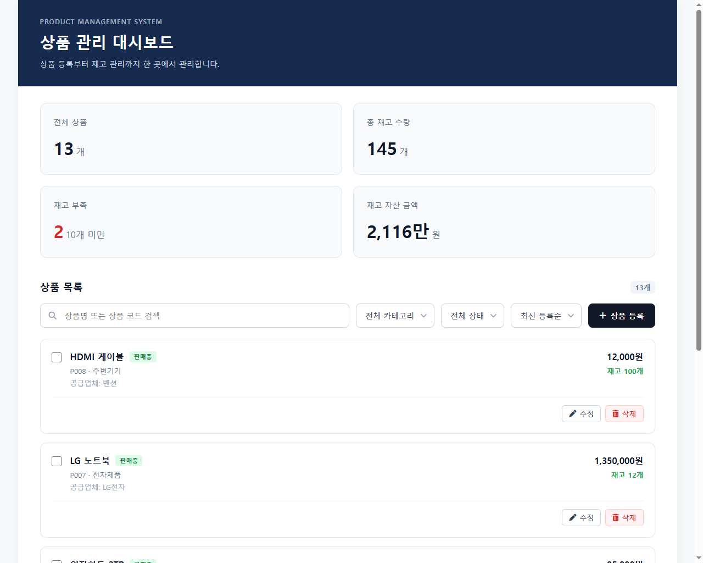

<div align="center">

# 상품 관리 시스템

**상품 등록부터 재고 현황까지 관리하는 웹 대시보드**

상품 정보를 한곳에서 조회하고, 검색·필터·정렬을 통해 필요한 재고를 빠르게 찾을 수 있습니다.

[](https://product-management-system-1-1n5s.onrender.com)
[](https://product-management-system-1-1n5s.onrender.com)
[](https://product-management-system-wqot.onrender.com)
[](https://www.python.org/)
[](https://product-management-system-wqot.onrender.com/docs)

</div>

---

## 서비스 화면



## 프로젝트 소개

상품과 재고를 관리하는 운영자를 위한 풀스택 웹 애플리케이션입니다. 대시보드에서 상품 목록과 재고 요약을 확인하고, 상품 등록·수정·삭제 및 조건별 목록 탐색을 할 수 있습니다.

## 주요 기능

| 기능 | 설명 |
| --- | --- |
| **재고 대시보드** | 상품 수, 재고 수량, 재고 부족 수, 재고 자산 요약 표시 |
| **상품 검색** | 상품명 또는 상품 코드로 검색 |
| **조건별 탐색** | 카테고리·판매 상태 필터와 최신 등록순·가격순·재고순 정렬 |
| **페이지네이션** | 페이지당 5개 상품 표시 및 페이지 이동 |
| **상품 관리** | 상품 등록, 상세 조회, 정보 수정 및 삭제 |
| **재고 기준 관리** | 상품별 수량과 안전 재고 기준 설정 |
| **입력값 검증** | 필수 항목, 음수 가격·재고, 중복 상품 코드 검증 |

## 기술 스택

### Frontend


### Backend


### Storage & Deployment


---

## 프로젝트 구조

```text
PRODUCT-MANAGEMENT-SYSTEM/
├── backend/
│   ├── main.py                 # FastAPI 앱, 요청 검증 및 API 라우트
│   ├── requirements.txt        # Python 의존성
│   ├── runtime.txt             # 배포 Python 버전
│   ├── service/
│   │   └── data.py             # 상품 검색·정렬·CRUD 및 JSON 처리
│   └── storage/
│       └── products.json       # 상품 데이터
└── frontend/
    ├── index.html              # 대시보드 화면
    ├── modal.html              # 상품 등록·수정 폼
    ├── css/
    │   ├── index.css
    │   └── modal.css
    └── js/
        ├── data_api.js         # API 통신 및 목록 렌더링
        └── modal.js            # 등록·수정 폼 동작
```

## 핵심 구현

### 검색·필터·정렬·페이지네이션 API

`GET /products`에서 검색어, 카테고리, 판매 상태, 정렬 기준, 페이지 번호와 페이지 크기를 받아 목록을 처리합니다. 필터링과 정렬 후 페이지 단위로 응답해 프론트엔드의 목록 탐색과 연동합니다.

```http
GET /products?keyword=키보드&category=주변기기&sort_by=price-asc&page=1&limit=5
```

### 요청 데이터 검증과 상품 코드

Pydantic 모델에서 상품명·카테고리 필수 여부와 가격·재고의 최솟값을 검증합니다. 상품 코드가 입력되지 않으면 ID 기반 코드(`P001` 형식)를 생성하고, 이미 사용 중인 코드가 전달되면 등록을 거부합니다.

### 프론트엔드와 API 연동

상품 목록과 카테고리 옵션을 API에서 불러오며, 모달 폼을 등록·수정 작업에 함께 사용합니다. 상품명이나 코드 입력, 필터와 정렬 변경 시 목록을 다시 요청하고, 삭제 전에는 사용자 확인을 거칩니다.

## API

| 메서드 | 경로 | 설명 |
| --- | --- | --- |
| `GET` | `/products` | 상품 목록 조회. 검색·필터·정렬·페이지네이션 지원 |
| `GET` | `/products/{product_id}` | 상품 상세 조회 |
| `POST` | `/products` | 상품 등록 |
| `PUT` | `/products/{product_id}` | 상품 정보 수정 |
| `DELETE` | `/products/{product_id}` | 상품 삭제 |

상세 요청·응답 스키마는 [Swagger API 문서](https://product-management-system-wqot.onrender.com/docs)에서 확인할 수 있습니다.

## 로컬 실행

### 사전 요구사항

- Python 3.10
- VS Code Live Server 등 정적 파일 서버

### 1. 백엔드 실행

저장소 루트에서 아래 명령을 실행합니다.

```powershell
cd backend
python -m venv .venv
.venv\Scripts\Activate.ps1
pip install -r requirements.txt
uvicorn main:a --reload
```

API 서버는 `http://127.0.0.1:8000`에서 실행됩니다. Swagger 문서는 `http://127.0.0.1:8000/docs`에서 확인할 수 있습니다.

### 2. 프론트엔드 실행

VS Code에서 `frontend` 폴더를 열고 Live Server로 `index.html`을 실행합니다. 현재 프론트엔드는 배포된 API 주소를 사용합니다. 로컬 백엔드에 연결하려면 `frontend/js/data_api.js`의 `API_BASE_URL`을 로컬 주소로 변경하고, `backend/main.py`의 CORS 허용 목록에 프론트엔드 로컬 origin을 추가해야 합니다.

## 개선 과제

- JSON 파일 저장을 데이터베이스로 전환해 동시 요청과 데이터 규모 증가에 대응
- 페이지별 목록과 별도로 전체 검색 결과 기준 요약 지표 제공
- 배포 환경별 API 주소 분리 및 자동화 테스트 추가